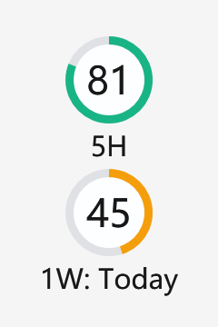

# codex-quota

阅读中文文档，请点击 [这里](README.md)。

Codex quota monitor / Read-only Codex quota monitor for Windows.

This is a read-only Windows quota monitor. It displays the 5H and 1W (weekly) quotas returned for the currently signed-in Codex account in a borderless floating window at the bottom left of Codex Desktop.

## UI Style



The floating window shows two vertically stacked quota rings: 5H above 1W. The number in each ring is the remaining percentage without a percent sign; the colored arc shows the remaining proportion. The label below identifies the quota and shows an expiry hint when triggered.

- **Green**: more than 60% remaining
- **Yellow**: 30%–60% remaining
- **Red**: less than 30% remaining

If the account has no 5H limit, only the 1W ring is shown. The rings appear above the official Usage icon, or above the account icon when Usage is unavailable.

## Expiry Hints

Expiry hints appear after the `5H` or `1W` label beneath the corresponding ring. If the reset time is missing, only the remaining number and label are shown.

- **5H**: Shows the local reset time, such as `12:00`, when the reset is in 1 hour or less, or when less than 20% remains.
- **1W**: Shows a hint when the reset is in 5 hours or less, more than 5 but no more than 24 hours away, or less than 20% remains. Once triggered, it shows the exact time when the reset is in 4 hours or less; otherwise it shows `Today` for a reset later today, `Tomorrow` for a reset tomorrow, or the month and day (for example, `Sep 21`) for a later date. The exact time takes priority over the day or date label.
- All stated time boundaries are inclusive (1, 5, 24, and 4 hours); the quota threshold is strictly below 20%.
- At 0% remaining, when a reset time is available, the 5H ring shows the reset time and the 1W ring shows the reset date in place of the number. Without a reset time, the center shows `0`.
- Labels use Chinese or English based on the system UI language; times and dates use local time and the corresponding language format.

## Requirements

- Windows 11 x64 or Windows 10 x64.
- The final installer does not require Microsoft .NET 10 Desktop Runtime to be pre-installed; if it is missing, the installer uses the official installer bundled inside the package.
- To generate an installer, `build-codex-quota.exe` requires the .NET SDK to be installed locally; if the local Runtime cache is absent, the first packaging run also requires an internet connection to download the official .NET 10 Desktop Runtime. Subsequent runs reuse the cache and embed it into the final installer, so users do not need to download it again during installation.

## Security Boundaries

- The monitor displays and reads data when a visible Codex Desktop window, the Codex runtime, and a signed-in account are present. It stops reading and hides when the window is closed or minimized, or authentication is unavailable, then retries when the conditions are restored. It can remain visible while another application is in front; that application's window covers any overlapping part of the overlay.
- It only calls `initialize`, `account/read` (`refreshToken: false`), and `account/rateLimits/read`, and only accepts `account/rateLimits/updated` notifications.
- It remains read-only: it does not sign in, sign out, switch accounts, reset quotas, create conversations, or send tasks. It does not read, copy, or write tokens, cookies, or `auth.json`.
- The App Server runs only as a local `stdio` child process and does not modify the Codex installation directory.

## Refresh Strategy

- Reads once at startup after confirming that the account is signed in.
- Reads again immediately when an account quota update notification is received.
- While Codex remains open, performs a fallback check every 60 seconds by default. The interval is controlled by `fallbackRefreshSeconds` in `config/settings.json`.

## Program Files

Installation directory:

```text
codex-quota.exe             Installed entry point; starts runtime/codex-quota.exe
codex-quota-launcher.exe    Startup listener bound to the Codex startup task
uninstall-codex-quota.exe   Removes the startup task, registration, and installation directory
runtime\codex-quota.exe     The actual Companion process
```

Source/packaging directory:

```text
build-codex-quota.exe       Asks where to generate the installer, then builds it
codex-quota-setup.exe       Final installer generated by build-codex-quota.exe
```
