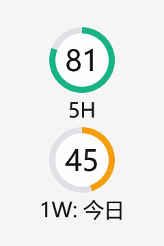

# codex-quota

Read the English documentation [here](README.en.md).

Codex 额度查询工具 / Read-only Codex quota monitor for Windows。

这是一个只读 Windows 额度查询工具，只显示当前已登录 Codex 账号返回的 5H 和 1W（周）额度，并在 Codex Desktop 左下角显示无边框浮窗。

## UI 样式



浮窗包含上下排列的额度圆圈：5H 在上，1W 在下。圆心数字表示剩余额度百分比，不显示百分号；圆环长度表示剩余比例，下方显示额度类型和按条件触发的到期提示。

- **绿色**：剩余额度大于 60%
- **黄色**：剩余额度为 30%–60%
- **红色**：剩余额度低于 30%

如果账号没有 5H 限制，只显示 1W 圆圈。圆圈位于官方“用量”图标上方；找不到该图标时，位于账号图标上方。

## 到期时间提示

到期提示显示在对应圆圈下方的 `5H` 或 `1W` 标识之后；缺少重置时间时只显示额度数字和标识。

- **5H**：距离重置不超过 1 小时，或剩余量低于 20% 时，显示本地重置时间，例如 `12:00`。
- **1W**：距离重置不超过 5 小时、超过 5 小时但不超过 24 小时，或剩余量低于 20% 时显示提示。触发后，距离重置不超过 4 小时显示具体时间；否则今天重置显示 `今日`，明天重置显示 `明日`，更晚日期显示 `月.日`，例如 `9.21`。
- 剩余量为 0 时：有重置时间时，圆心的 5H 数字替换为重置时间、1W 数字替换为 `月.日` 格式的重置日期；没有重置时间时圆心显示 `0`。
- 文案根据系统界面语言显示中文或英文；时间与日期使用本地时间和相应语言格式。

## 运行前提

- Windows 11 x64 或 Windows 10 x64。
- 运行最终安装包前无需预先安装 Microsoft .NET 10 Desktop Runtime；安装包检测不到时会使用包内的官方安装程序完成安装。
- 如果需要生成安装包，`build-codex-quota.exe` 需要本机安装 .NET SDK；当本机没有 Runtime 缓存时，首次打包还需要联网下载官方 .NET 10 Desktop Runtime，之后会复用缓存并将其嵌入最终安装包，用户安装时无需再次下载。

## 安全边界

- 在可见的 Codex Desktop 窗口、Codex 运行时和已登录账号存在时显示并读取；窗口关闭、最小化或认证不可用时停止读取并隐藏，恢复后重试。其他应用在前台时，浮窗可继续显示，前方窗口会遮住其覆盖的区域。
- 仅调用 `initialize`、`account/read`（`refreshToken: false`）和 `account/rateLimits/read`，并只接收 `account/rateLimits/updated` 通知。
- 保持只读：不登录、登出、切换账号、重置额度、创建对话或发送任务；不读取、复制或写入 Token、Cookie、`auth.json`。
- App Server 仅通过本地 `stdio` 子进程运行，不修改 Codex 安装目录。

## 刷新策略

- 启动且确认已登录后读取一次。
- 收到额度更新通知后立即重新读取一次。
- 仅在 Codex 仍打开时，默认每 60 秒进行一次兜底检查；间隔由 `config/settings.json` 中的 `fallbackRefreshSeconds` 控制。

## 程序文件说明

安装目录：

```text
codex-quota.exe             安装后启动入口，启动 runtime/codex-quota.exe
codex-quota-launcher.exe    启动监听器，绑定 Codex 启动任务
uninstall-codex-quota.exe   卸载任务、注册信息和安装目录
runtime\codex-quota.exe     实际运行的 Companion
```

源码/打包目录：

```text
build-codex-quota.exe       询问安装包生成位置，再执行构建
codex-quota-setup.exe       build-codex-quota.exe 生成的最终安装包
```
